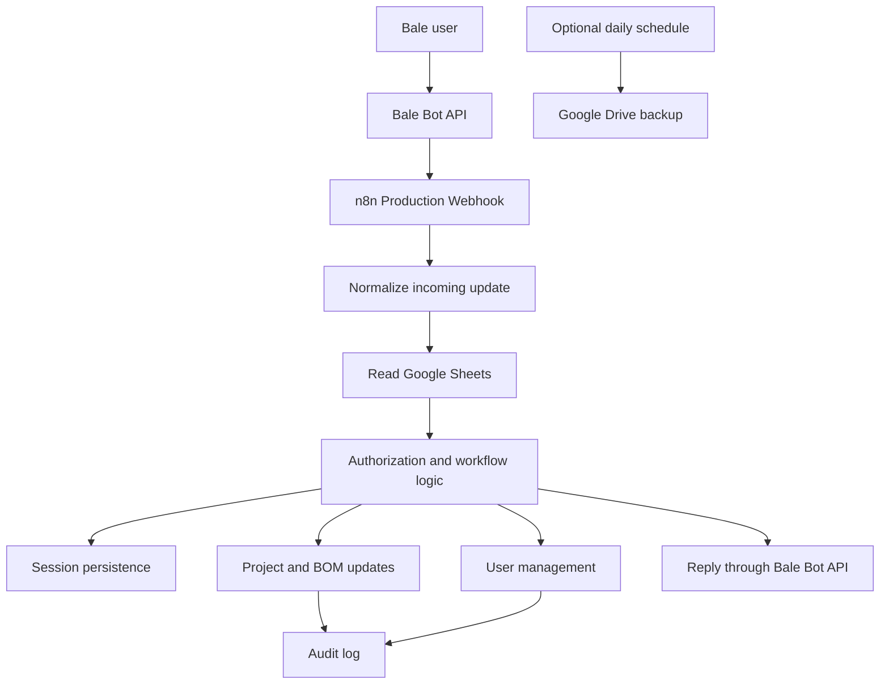

# CONEX ID BOT
### n8n-based project lookup, BOM tracking, access control, and audit workflow

CONEX ID BOT is an automation workflow built with **n8n**, the **Bale Bot API**, and **Google Sheets**. It provides a chat-based interface for authorized users to search project records, review BOM status, and let administrators create or update project information.

> **Repository status:** setup template. Credentials, spreadsheet IDs, the administrator ID, the Data Table ID, and the production webhook path must be configured in your own n8n instance before use.

## Features

- Search projects by project name, project group, or SAP code
- Browse paginated project lists
- Filter projects by BOM registration status
- View project details
- Administrator-only project creation and editing
- User access management with `admin` and `viewer` roles
- Persistent multi-step conversations using a Sessions sheet
- Audit logging for project and user changes
- Bale inline buttons and a fixed reply keyboard in the full workflow
- Optional daily Google Drive backup (disabled until configured)

## Architecture



## Repository layout

```text
CONEX-ID-BOT/
├── README.md
├── .gitignore
├── .env.example
├── workflows/
│   ├── conex-id-bot-full.json
│   └── legacy/
│       └── conex-id-bot-env-token-legacy.json
└── docs/
    ├── installation.md
    ├── database-schema.md
    └── security.md
```

## Which workflow should I import?

| File | Purpose | Recommendation |
|---|---|---|
| `workflows/conex-id-bot-full.json` | Full version with fixed reply keyboard, inline-message editing, and Bot Token lookup from an n8n Data Table | **Recommended** |
| `workflows/legacy/conex-id-bot-env-token-legacy.json` | Earlier alternative that reads the Bale token from `$env.BALE_BOT_TOKEN` | Legacy reference only |

Import and activate **only one version** in an n8n instance at a time. Both exports use the same placeholder webhook path until you configure it.

## Quick start

1. Create the Google Spreadsheet and tabs described in [`docs/database-schema.md`](docs/database-schema.md).
2. Import `workflows/conex-id-bot-full.json` into n8n.
3. Configure Google Sheets credentials and the Spreadsheet ID in every Google Sheets node.
4. Create the `bale_bot_config` n8n Data Table, add `config_key` and `config_value` columns, and add a row whose `config_key` is `BALE_BOT_TOKEN`.
5. Set the Data Table ID in the **Load Bot Token** node.
6. In **Plan Bot Response**, replace `REPLACE_WITH_YOUR_BALE_USER_ID` with the verified Bale user ID of the initial administrator. Do this only in your private n8n instance, not in this repository.
7. Change the Webhook node path to a new random value, publish/activate the workflow, and register its Production URL with Bale.
8. Test with at least two authorized accounts before using real operational data.

Detailed instructions are in [`docs/installation.md`](docs/installation.md).

## Security and data handling

- Never commit bot tokens, API keys, OAuth credentials, service-account JSON files, production webhook URLs, real administrator IDs, or operational project data.
- Store credentials in n8n Credentials or a protected secret store.
- Keep this repository **private by default** if the workflow is used for internal company operations. Make it public only after receiving permission to disclose the workflow and its business logic.
- The workflow is a template; the organization using it is responsible for reviewing access control, webhook authenticity, data retention, and concurrency requirements before production use.
- See [`docs/security.md`](docs/security.md).

## Persian summary

این پروژه یک ربات بله مبتنی بر n8n برای جست‌وجو و مدیریت اطلاعات پروژه‌ها و وضعیت BOM است. اطلاعات در Google Sheets نگهداری می‌شوند و دسترسی مدیر و مشاهده‌گر، ثبت نشست کاربران و گزارش تغییرات در آن پیش‌بینی شده است. نسخه کامل برای راه‌اندازی پیشنهاد می‌شود؛ قبل از اجرا باید شناسه‌ها، اعتبارنامه‌ها و مسیر Webhook در محیط شخصی n8n تنظیم شوند.

## License

No open-source license is included. Unless a license is added, reuse and redistribution are not automatically granted.
